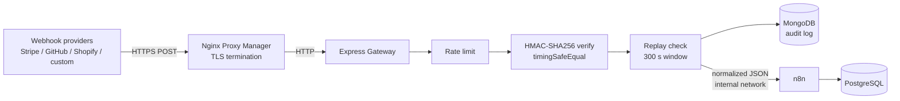

# Secure Self-Hosted n8n Stack with a Webhook Gateway

A containerized, production-style automation stack. External webhooks never touch n8n directly: they pass through a custom Node.js/Express gateway that authenticates, rate-limits, audits and normalizes them first.



## What it demonstrates

| Requirement | Implementation |
|---|---|
| FR-01 / FR-102 TLS ingress | Nginx Proxy Manager with Let's Encrypt |
| FR-02 HMAC verification | `gateway/src/utils/signature.js`, native `crypto`, `timingSafeEqual` |
| FR-03 Replay protection | `gateway/src/utils/replay.js`, rejects timestamps older than 300 s |
| FR-04 Audit persistence | Every attempt (accepted or rejected) stored in MongoDB |
| FR-05 Normalization | One internal JSON schema regardless of provider |
| FR-06 Internal dispatch | Gateway to n8n over an `internal: true` Docker network |
| FR-101 / NFR-03 Persistence | n8n on PostgreSQL, named volumes for every stateful service |
| FR-104 / NFR-01 Secrets | `.env` only, nothing hardcoded |

## Quick start (local, no domain)

```bash
cp .env.example .env          # then replace every change_me with: openssl rand -hex 32
docker compose -f docker-compose.yml -f docker-compose.dev.yml up -d --build
```

1. Open http://localhost:5678 and create the n8n owner account.
2. Create a workflow: **Webhook** node, method POST, path `gateway-intake`, Authentication = **Header Auth** with header name `X-Gateway-Token` and value = your `N8N_GATEWAY_TOKEN`. Activate the workflow.
3. Send a signed test event:

```bash
cd gateway
CUSTOM_WEBHOOK_SECRET=<value from .env> node scripts/send-test-webhook.js            # 202 accepted
CUSTOM_WEBHOOK_SECRET=<value from .env> node scripts/send-test-webhook.js --tamper    # 401 invalid signature
CUSTOM_WEBHOOK_SECRET=<value from .env> node scripts/send-test-webhook.js --stale     # 400 expired
```

Each attempt, including the rejected ones, appears in the `webhookevents` collection in MongoDB.

## Production deployment

1. Point DNS for `N8N_HOST` and `GATEWAY_HOST` at the server.
2. `docker compose up -d --build`
3. Open Nginx Proxy Manager at `http://<server>:81` (default login is in its docs; change it immediately), then add two proxy hosts with Let's Encrypt SSL:
   - `GATEWAY_HOST` to `gateway:3000`
   - `N8N_HOST` to `n8n:5678` (enable WebSockets support)
4. Block port 81 from the public internet (firewall or SSH tunnel).

## Gateway endpoints

| Method | Path | Purpose |
|---|---|---|
| POST | `/webhooks/:provider` | `stripe`, `github`, `shopify`, `custom` |
| GET | `/health` | Liveness and MongoDB status |

Signature schemes: Stripe `Stripe-Signature` (`t=…,v1=…`), GitHub `X-Hub-Signature-256`, Shopify `X-Shopify-Hmac-Sha256` (base64), custom `X-Signature` + `X-Timestamp` signing `"<timestamp>.<body>"`. GitHub and Shopify do not sign a timestamp, so replay protection applies to Stripe and custom only.

## Security notes

- The raw request bytes are verified, never re-serialized JSON.
- Rejected requests get a generic `401`; the precise reason is only in the audit log.
- n8n's webhook is protected by Header Auth, so even if someone reaches `https://<N8N_HOST>/webhook/...` directly, they are rejected without the gateway token.
- Databases sit on an internal-only network with no published ports.
- The gateway acknowledges with `202` after persisting, then forwards to n8n in the background, and the audit record moves to `PROCESSED` or `FAILED`.

## Tests

```bash
cd gateway && npm install && npm test
```

## Roadmap

- Idempotency / dedupe on provider delivery IDs
- Retry queue for failed n8n deliveries
- Integration tests with supertest and mongodb-memory-server
- GitHub Actions CI building the image
